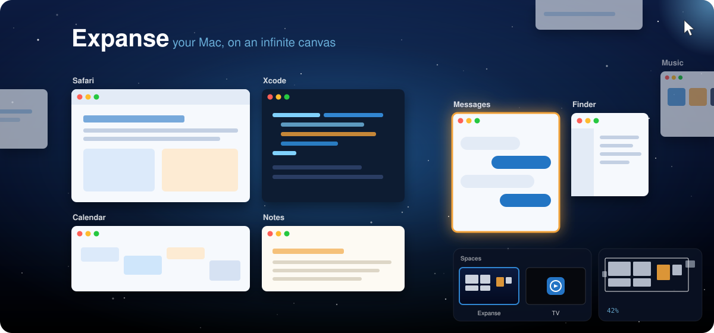

<p align="center">
  
</p>

<h1 align="center">Expanse</h1>

<p align="center">
  <strong>Your Mac, on an infinite canvas.</strong><br>
  Every window gets a place on one endless, zoomable desktop. Zoom out to see everything.<br>
  Dive into a window to use it. No SIP changes, no hacks, and quitting puts everything back.
</p>

<p align="center">
  
  
  
</p>

---

Your screen is a window onto something much bigger. Expanse treats the desktop as a camera over
an infinite canvas: windows live at fixed places on it, and you move the camera, not the
windows. Pinch out and your whole working world is laid out in front of you. Click a window and
the canvas glides to it, centred, at 100%, ready to type into.

## Highlights

- **Zoom out to everything, dive into anything.** Rest the pointer in a screen corner (or press
  <kbd>⌥</kbd><kbd>`</kbd>) to see every window at once. Click one to fly to it.
- **Silky.** Panning, zooming and gliding run at 120 fps: the camera is a single GPU
  transform, and real windows are only moved once the motion stops.
- **Spatial navigation.** <kbd>⌃</kbd> + arrow keys hop to the nearest window in that direction.
  Press quickly and the hops chain into one continuous move.
- **Arrange like a design tool.** Drag windows around the canvas; they snap to edges, centres
  and an even 20pt gap. Box-select or <kbd>⇧</kbd>-click to move groups together.
- **Follows you between screens.** Expanse keeps a *home* layout at full size. On a laptop the
  layout tightens up (each window keeps its gap to its neighbours); plug back into the big
  display and everything returns exactly.
- **Tidy Up** (<kbd>T</kbd>): fit windows to the current screen, push overlaps apart and pull each
  group back to even gaps, without rebuilding your layout.
- **New windows open in free space**, next to what you were working on, instead of on top of it.
- **Switch in and out cleanly.** Pause or quit and every window goes back to exactly where macOS
  had it. Launch again and the canvas comes back. Even after a crash, the next quit restores
  your original layout.
- **Your desktop picture** as the canvas, live from what macOS is drawing (dynamic wallpapers
  included).
- **Scriptable** through `expanse://` URLs.

## Install

Expanse is built from source for now. You need macOS 15 or later and the Swift 6 toolchain
(Xcode 16+ or the Command Line Tools).

```bash
git clone https://github.com/invig/expanse.git
cd expanse
./scripts/build.sh
open build/Expanse.app
```

On first launch a short walkthrough explains the two permissions Expanse needs and opens the
right System Settings pages:

| Permission | Why |
|---|---|
| **Accessibility** | To move, resize and focus your windows as you move around the canvas. |
| **Screen Recording** | To show live pictures of your windows while you're zoomed out. |

> **Signing.** `build.sh` signs with your *Apple Development* certificate if you have one, so
> the permissions survive rebuilds. Without one it signs ad hoc, which works, but macOS will
> ask for the permissions again after every rebuild.

### Optional: free up two macOS shortcuts

macOS uses screen corners and <kbd>⌃</kbd> + arrows too, and it gets them first. If you want
Expanse to have them:

- **Hot corners:** System Settings › Desktop & Dock › Hot Corners, set the corners you want to “–”.
- **⌃ + arrows:** System Settings › Keyboard › Keyboard Shortcuts › Mission Control, turn off
  *Mission Control*, *Application windows* and *Move left/right a space*.

## Using Expanse

| Input | What it does |
|---|---|
| <kbd>⌥</kbd><kbd>`</kbd>, or rest the pointer in a screen corner | Zoom out to every window, and back to where you were |
| Click a window | Fly to it, centred at 100%, and use it |
| <kbd>⌃</kbd> + <kbd>←</kbd><kbd>→</kbd><kbd>↑</kbd><kbd>↓</kbd> | Jump to the nearest window in that direction |
| Pinch, or <kbd>⌘</kbd> + scroll | Zoom the canvas around the pointer |
| Two-finger scroll, or <kbd>Space</kbd> + drag | Pan |
| Scroll or pinch on empty desktop | Start moving around the canvas from 100% |
| Drag a window | Move it; snaps to edges, a 20pt gap and the middle of the screen (hold <kbd>⌘</kbd> to turn snapping off) |
| Drag on empty canvas, <kbd>⇧</kbd>-click, <kbd>⌘</kbd><kbd>A</kbd> | Select windows; drag any selected one to move the group |
| <kbd>T</kbd> | Tidy up |
| <kbd>0</kbd> · <kbd>1</kbd> · <kbd>-</kbd> · <kbd>=</kbd> | Fit everything · 100% · zoom out · zoom in |
| <kbd>Return</kbd> · <kbd>Esc</kbd> | Dive into the highlighted window · clear selection, then back to 100% |
| Hover <kbd>×</kbd>, or <kbd>⌘</kbd><kbd>W</kbd> | Close the hovered window |
| <kbd>⌥</kbd><kbd>⇧</kbd><kbd>`</kbd> | Auto-centre on or off. Off: clicking a window that's partly on screen leaves the canvas where it is, for side-by-side work |
| Menu bar icon | Hot corner choice, desktop picture, Pause, Tidy Up, Restore All Windows, Welcome & Shortcuts |

### Scripting

```bash
open "expanse://toggle"            # zoom out / back
open "expanse://tidy"
open "expanse://nav?dir=left"      # left | right | up | down
open "expanse://focus?app=Safari"
open "expanse://pause"             # windows back to the macOS layout
open "expanse://resume"
```

Also `enter`, `exit`, `fit`, `zoom?scale=0.5`, `pan?dx=100&dy=0`, `restore`, and for debugging
`dump` and `screen?w=1512&h=982` (pretend the display is that size).

## How it works

Expanse runs on a stock, SIP-enabled Mac. That shapes everything:

- **Camera.** Every window has a frame in canvas space; a camera (origin + scale) maps the
  canvas to the screen. The layout is saved to `~/Library/Application Support/Expanse/`.
- **At 100%, windows are real.** They sit exactly where the camera says, moved with the
  Accessibility API. Windows outside the view are *parked* in the bottom-right corner of the
  screen, with one pixel showing (the trick [AeroSpace](https://github.com/nikitabobko/AeroSpace)
  uses). A full-screen backdrop sits beneath all windows, drawing the desktop picture and
  parked windows where they belong on the canvas.
- **Zoomed out, windows are pictures.** The backdrop rises above everything and draws each
  window from its own ScreenCaptureKit stream. Desktop-independent window capture keeps working
  for covered and parked windows, so the whole canvas stays live. Panning and zooming only touch
  one Core Animation transform, so nothing reflows and it stays at 120 fps.
- **Gliding** between windows at 100% uses the same trick for a moment: the backdrop rises with
  pictures exactly over the real windows, the camera animates, and the real windows move once,
  hidden, on a background thread.
- **Capture only when it's needed.** macOS marks every captured window with a purple indicator.
  At 100% the windows on screen are the real thing, so Expanse only captures them while zoomed
  out or gliding (when the backdrop covers them anyway), plus parked windows whose indicator is
  off-screen.
- **Display changes.** While macOS reshuffles windows after a display change, Expanse ignores
  their moves, then restores sizes and derives the layout for the new screen from the home
  layout.
- **Focus** switches through the Accessibility API, which lands in milliseconds instead of
  waiting on macOS's cooperative app activation.

## Privacy

Window pictures exist only in memory, on your Mac, to draw the canvas. Nothing is recorded,
written to disk or sent anywhere. Expanse makes no network connections. The only file it writes
is its layout (window positions and sizes, app names and window titles) in
`~/Library/Application Support/Expanse/layout.json`.

## Limitations

- **One display.** Expanse manages the main display; multi-monitor support is on the list.
- **You can't type into a window while zoomed out.** Real window scaling needs code injected into
  the Dock, which needs SIP disabled. Expanse deliberately doesn't go there.
- **Window titles can't sit above the menu bar.** A window whose top would be above the screen
  stays parked, and the backdrop shows it in place; click it to bring it in.
- Some apps fight being moved (they snap themselves back, or animate). Expanse copes with the
  common cases; please open an issue for ones it doesn't.

## Developing

```bash
./scripts/build.sh && open build/Expanse.app
log stream --level info --predicate 'subsystem == "com.invignation.expanse"'
```

The log shows every window Expanse moves, resizes or follows, glide timings, and anything slow.
`open "expanse://dump"` writes the full layout to it.

## Thanks

- [Sunlight](https://x.com/deezel/status/2114386503312839087) by Darin Dimitroff, which
  inspired this. Sunlight's full mode goes further with SIP disabled; Expanse explores how far a
  stock Mac can go.
- [AeroSpace](https://github.com/nikitabobko/AeroSpace) for the corner-parking idea, and
  [Rectangle](https://github.com/rxhanson/Rectangle) and [yabai](https://github.com/koekeishiya/yabai)
  for years of public knowledge about macOS window management.

## Licence

[MIT](LICENSE)
